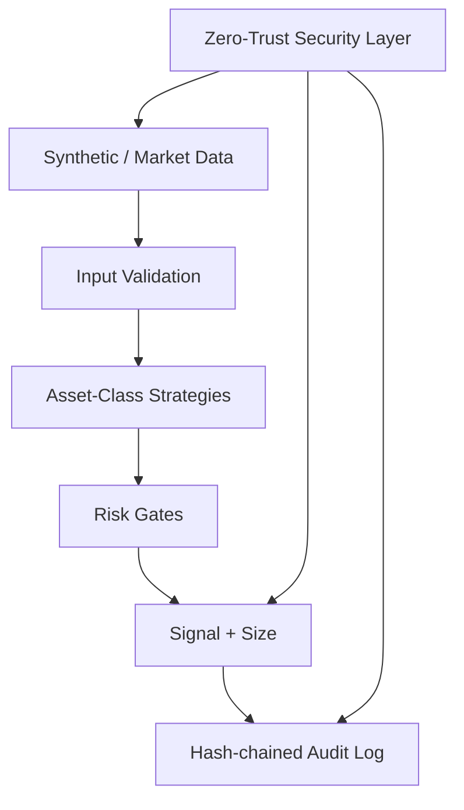

# Architecture (v16)

Modular paper-only crypto trading information system.

Components:
- `data.py`: synthetic generator + validation
- `strategies.py`: per-asset-class multi-factor adaptive logic
- `risk.py`: drawdown, position, regime, confidence gates
- `security.py`: encryption, redaction, anomaly, audit
- `cli.py`: demo and signal generation

No live order execution. Designed for research, backtesting extension, and safe AI-agent development.
